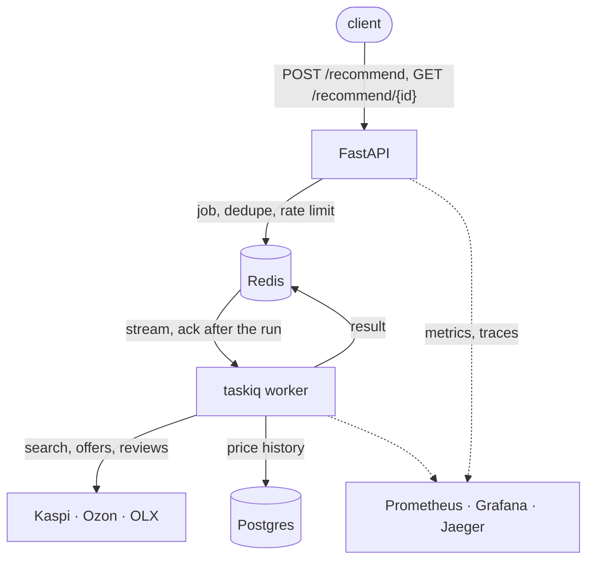

**English** | **[Русский](README.ru.md)**

<p align="center">
  
</p>

[](https://github.com/octrow/buy-smarter/actions/workflows/ci.yml)
[](LICENSE)


Ranks Kaspi, Ozon and OLX offers for your budget and city, and shows why.

You describe what you need ("a portable water flosser, IPX7, under 40,000 ₸, Almaty").
buy-smarter searches Kaspi.kz, Ozon.kz and OLX.kz (used items).
It ranks offers for your budget, city and must-have features.
Each pick shows which axes scored it and why.

It runs as a CLI, a desktop app, an MCP server for Claude and an HTTP API.

## Quick start

Kaspi needs a Kazakhstan IP: datacenter IPs get HTTP 429 (set `KASPI_PROXY` to a residential proxy).

macOS / Linux:

```bash
curl -LsSf https://raw.githubusercontent.com/octrow/buy-smarter/main/install.sh | sh
```

Windows (PowerShell):

```powershell
powershell -ExecutionPolicy ByPass -c "irm https://raw.githubusercontent.com/octrow/buy-smarter/main/install.ps1 | iex"
```

The installer gets [uv](https://docs.astral.sh/uv/) (it brings its own Python), installs the latest release with the desktop app, and runs `buysmarter doctor`.
`doctor` says what is missing and what that turns off.
Update with `buysmarter update`. Remove with `sh -s -- --uninstall`.
API keys and a proxy go in `~/.config/buysmarter/.env` (see [.env.example](.env.example)).

Then run your first search:

```bash
buysmarter recommend "need a water flosser, portable, IPX7, under 40000 tg, Almaty"
```

No terminal? Each release has a `.deb` and builds for Windows, macOS and Linux: [install the desktop app](docs/install-desktop.md).
Developing? See [install from source](docs/development.md).

## What the app looks like

The desktop app (`buysmarter gui`) opens the same reports and has a dark theme.

<table>
  <tr>
    <td width="50%"></td>
    <td width="50%"></td>
  </tr>
</table>

## What it does

- Reads the Kaspi and OLX JSON endpoints directly, and keeps working when one source is down.
- Discounts gamed reviews: five-star bursts, junk texts, unverified purchases, defect complaints.
- Checks your must-have features against specs, then against review quotes.
- Learns brands and models for a new category (`learn-category`), also on the first query.
- Adds used items from OLX, phone specs from Kimovil and price history.

More in [features in detail](docs/features.md). Closest open-source projects: [analogs](docs/analogs/README.md).

## How it runs

One pipeline sits behind the CLI, the MCP server and the API.
A run takes tens of seconds.
The API puts it on a Redis stream, a worker runs it, and the client polls for the result.



## More docs

- [CLI usage and LLM cache](docs/usage.md)
- [MCP server](docs/mcp.md): tools and Claude Desktop setup
- [HTTP API](docs/http-api.md): jobs, statuses, rate limits
- [Docker, Kubernetes, observability](docs/deploy.md), with Grafana and Jaeger screenshots
- [Development](docs/development.md): `make check`, layout, tests

## Limits

- Kaspi needs a Kazakhstan residential IP or `KASPI_PROXY`.
- Ozon may still show its anti-bot page; `ozon-setup` refreshes the saved session.
- Review velocity is displayed but not scored yet.
- A burst of requests can get the IP blocked by Kimovil for a while.
  Until it clears, only cached phone specs are used.
- The marketplace endpoints are unofficial and can change without notice.

## License

[MIT](LICENSE). Third-party code is listed in [THIRD_PARTY_NOTICES.md](THIRD_PARTY_NOTICES.md).
