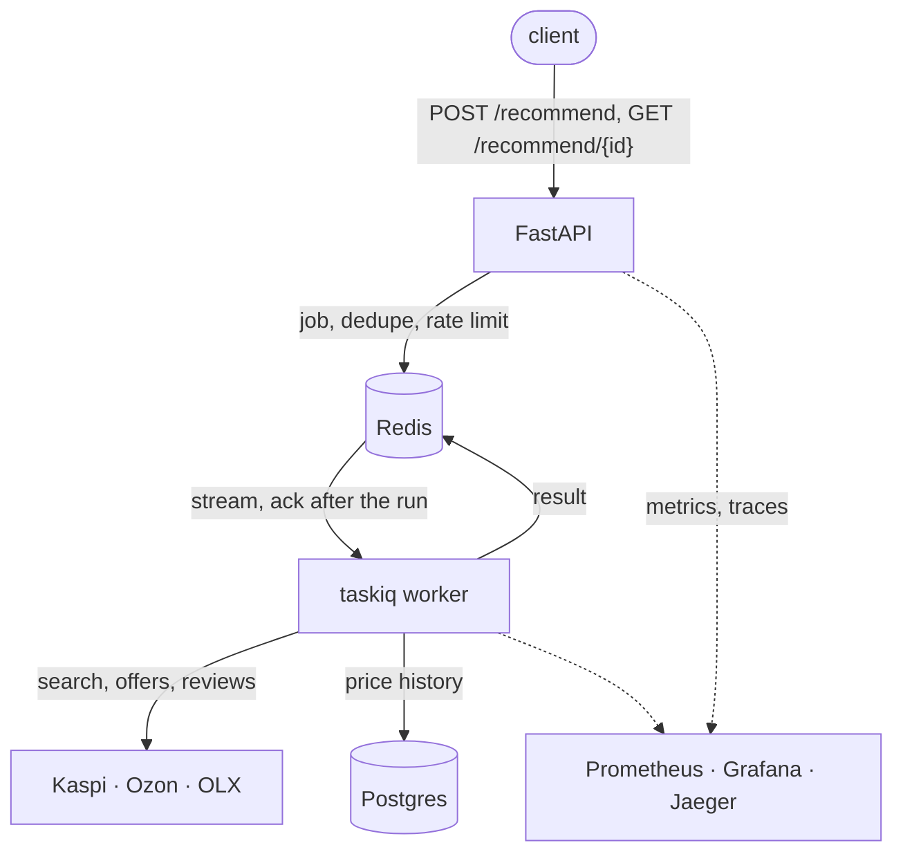

**[English](README.md)** | **Русский**

<p align="center">
  
</p>

[](https://github.com/octrow/buy-smarter/actions/workflows/ci.yml)
[](LICENSE)


Ранжирует предложения Kaspi, Ozon и OLX под ваш бюджет и город и объясняет выбор.

Вы описываете, что нужно («портативный ирригатор, IPX7, до 40 000 тг, Алматы»).
buy-smarter ищет на Kaspi.kz, Ozon.kz и OLX.kz (б/у) и ранжирует предложения под ваш бюджет, город и обязательные функции.
Для каждого варианта видно, по каким осям он набрал баллы и почему, и что проверить не удалось.
Работает как CLI, десктоп-приложение, MCP-сервер для Claude и HTTP API.

## Быстрый старт

Для Kaspi нужен казахстанский IP: датацентровым IP он отвечает HTTP 429 (задайте `KASPI_PROXY` с резидентным прокси).

macOS / Linux:

```bash
curl -LsSf https://raw.githubusercontent.com/octrow/buy-smarter/main/install.sh | sh
```

Windows (PowerShell):

```powershell
powershell -ExecutionPolicy ByPass -c "irm https://raw.githubusercontent.com/octrow/buy-smarter/main/install.ps1 | iex"
```

Установщик ставит [uv](https://docs.astral.sh/uv/) (он сам принесёт Python), последний релиз с десктоп-приложением и запускает `buysmarter doctor`.
`doctor` скажет, чего не хватает и что от этого отключится.
Обновление: `buysmarter update`. Удаление: `sh -s -- --uninstall`.
API-ключи и прокси кладутся в `~/.config/buysmarter/.env` (образец в [.env.example](.env.example)).

Затем запустите первый поиск:

```bash
buysmarter recommend "нужен ирригатор, портативный, IPX7, до 40000 тг, Алматы"
```

Без терминала? В каждом релизе есть `.deb` и сборки для Windows, macOS и Linux: [установка приложения](docs/install-desktop.ru.md).
Разработка? См. [установку из исходников](docs/development.ru.md).

## Как выглядит приложение

Десктоп-приложение (`buysmarter gui`) открывает те же отчёты, есть тёмная тема.

<table>
  <tr>
    <td width="50%"></td>
    <td width="50%"></td>
  </tr>
</table>

## Что умеет

- Читает JSON-эндпоинты Kaspi и OLX напрямую и работает, даже если один источник недоступен.
- Занижает вес накрученных отзывов: всплески пятёрок, мусорные тексты, непроверенные покупки, жалобы на брак.
- Проверяет ваши обязательные функции по характеристикам, затем по цитатам из отзывов.
- Изучает бренды и модели новой категории (`learn-category`), в том числе при первом запросе.
- Добавляет б/у с OLX, характеристики телефонов с Kimovil и историю цен.

Подробнее: [возможности](docs/features.ru.md). Ближайшие открытые проекты: [аналоги](docs/analogs/README.md).

## Как это работает

За CLI, MCP-сервером и API стоит один пайплайн.
Подбор идёт десятки секунд, поэтому API кладёт его в Redis Stream, выполняет воркер, а клиент опрашивает результат.



## Ещё документация

- [CLI и кэш LLM](docs/usage.ru.md)
- [MCP-сервер](docs/mcp.ru.md): инструменты и настройка Claude Desktop
- [HTTP API](docs/http-api.ru.md): задачи, статусы, лимиты
- [Docker, Kubernetes, наблюдаемость](docs/deploy.ru.md), со скриншотами Grafana и Jaeger
- [Разработка](docs/development.ru.md): `make check`, структура, тесты

## Ограничения

- Для Kaspi нужен резидентный казахстанский IP или `KASPI_PROXY`.
- Ozon может показать антибот-страницу; `ozon-setup` обновляет сохранённую сессию.
- Скорость появления отзывов показывается, но пока не входит в оценку.
- Kimovil после всплеска запросов может на время заблокировать IP; тогда используются только кэшированные характеристики телефонов.
- Эндпоинты площадок неофициальные и могут измениться без предупреждения.

## Лицензия

[MIT](LICENSE). Сторонний код перечислен в [THIRD_PARTY_NOTICES.md](THIRD_PARTY_NOTICES.md).
