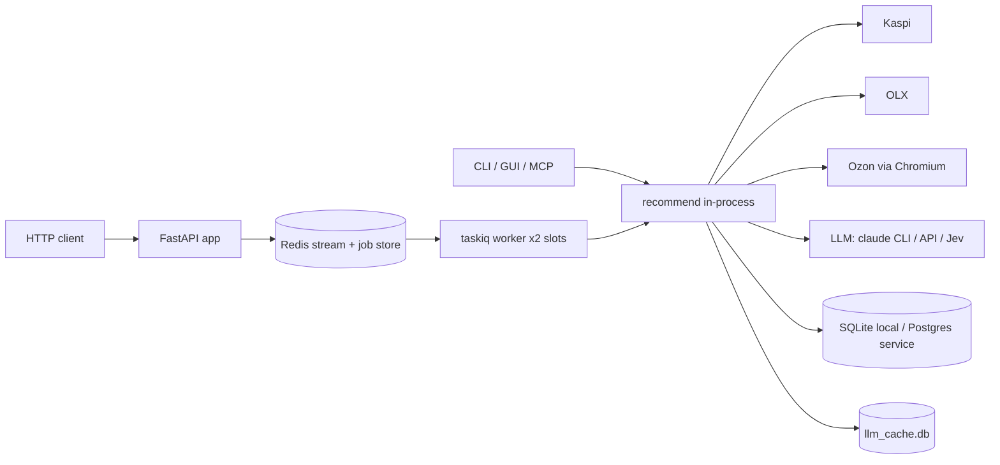

# System design review: buy-smarter

Reviewed 2026-11-05. Stack, entry points, data flow and step-level behaviour are in [logic-map.md](logic-map.md); not repeated here.

## Assumptions

| # | Fact | Label |
|---|------|-------|
| 1 | One real user (the owner). Primary surfaces: CLI, PySide6 desktop GUI, MCP. HTTP API + taskiq worker is a deployable option, no live public instance. | measured (docs/PLAN.md "Отложено": no live demo URL) |
| 2 | 205 completed runs in `~/.cache/buysmarter/logs/buysmarter.log`, 2026-07-18 to 2026-11-01. | measured (`stage total took` count) |
| 3 | 86 saved reports; busiest day 10 reports (2026-11-01), typically 1-5. | measured (`ls ~/.local/share/buysmarter/reports`) |
| 4 | Run latency (end to end, includes LLM and marketplaces): min 6.8 s, median 43 s, p95 141 s, max 323 s. | measured (205 `stage total` lines) |
| 5 | `collect[kaspi]` mean 32 s (n=242), `collect[olx]` mean 3.8 s (n=170): Kaspi is ~75% of the median run. | measured (log `stage ... took`) |
| 6 | Local DB `buysmarter.db` 8.6 MB: products 1883, offers 8760, price_snapshots 4759, category_knowledge 58, style_vectors 615, reviews 0. | measured (sqlite read-only) |
| 7 | LLM response cache `llm_cache.db` 3.0 MB, 308 rows; 242 cache hits logged; `claude` CLI failures 3. | measured (sqlite, log grep) |
| 8 | HTTP requests to marketplaces: 2117 in the log; 142 lines mention 429/403. | measured (log grep, 429/403 count is a loose match) |
| 9 | Style model cache 303 MB, `~/.cache/buysmarter` 310 MB total, log cap 5 MB x 5 files. | measured (du, `logsetup.py:20`) |
| 10 | Hypothetical API use: 50 users x 10 searches/day. | assumed (for the x10 question only) |
| 11 | LLM cost per run: not measured here (route is claude CLI or OmniRoute, subscription). | assumed unknown |

Kind: app (desktop + CLI + MCP) with an optional service mode (FastAPI + Redis + Postgres + taskiq worker). Code: 25,976 lines in `src/`, 476 commits, 476 in the last 30 days (very active, single author).

## 0. What exists

- Local mode: SQLite (`buysmarter.db`, sync/async via `db/repo`), llm_cache.db, kimovil.db, markdown reports on disk. No server, no cron. Updates via git or `uv tool`.
- Service mode (`docker-compose.yml`): postgres:16, redis:7, `migrate` job, `app` (uvicorn :8000), `worker` (`taskiq worker --workers=1 --max-async-tasks=2`, metrics :9000). Optional OTLP traces, optional Chromium image for Ozon.
- External dependencies per run: Kaspi (scraped JSON endpoints), OLX, Ozon (real browser), Kimovil, brand sites (schema.org), LLM (claude CLI / API / Jev). Entry points and step list: [logic-map.md](logic-map.md) "Entry points", "The flow at a glance".
- Ladder rung today (`references/scale-ladder.md`): rung 1, a single process on one machine. The service mode is rung 2 in shape (app, worker, DB, queue) but carries no real traffic.

## 1. Requirements

One sentence: given a free-text shopping query, return a ranked, explained pick from Kaspi, Ozon and OLX in under a minute.

Functional (in scope): recommend (parse, collect, rank, explain), clarify, learn a category, price tracking (`refresh`, `history`), saved preferences. Out of scope: checkout, accounts, multi-tenant data.

Non-functional (assumed, owner-driven):
- Scale: 1 user, about 3 runs/day (205 runs over ~106 days is about 2/day average, 10/day peak).
- Latency: interactive; median 43 s is accepted today, p95 141 s tolerated, no target is written down.
- Availability: downtime fine (desktop tool); marketplaces failing must degrade, not crash (`failed_sources`).
- Consistency: prices are as of scrape time; snapshots append-only.
- Durability: category knowledge and style samples are the only irreplaceable data (58 records, 615 vectors); price history is nice to have.
- Security: no payments; LLM keys in env/keyring; API key optional (`BUYSMARTER_API_KEYS`).
- Observability: rotating log with stage timings, optional OTLP.

## 2. Napkin math

The napkin script models request traffic; at this scale it only confirms rung 1. The real constraint is per-run wall time, computed below separately.

```
$ napkin.py --dau 1 --req-per-user 10 --peak 3 --read-share 0.5 --server-rps 0.05 --object-kb 20 --write-kb 200 --response-kb 20 --retention-years 5
requests/day 10, peak 0.0 req/s | servers 2 (at 0.05 rps each) | cache 20 kB
DB writes 0.0 w/s -> 1 shard, 0 replicas | storage 1.1 GB/year, 5.5 GB after 5 years
verdict: rungs 1-2: one good VPS. Ship it.

$ napkin.py --dau 50 --req-per-user 10 --peak 5 ... --retention-years 1   (assumed x50 API users)
requests/day 500 | servers 2 | cache 1.0 MB | storage 54.8 GB/year
verdict: rungs 1-2: one good VPS. Ship it.
```

Storage caveat: napkin uses 200 kB/write x3 replication. Measured reality is 8.6 MB for 1883 products, about 4.6 kB per product, so the napkin storage figure is a very loose upper bound.

Worker capacity (computed with python3, `--max-async-tasks=2` from `docker-compose.yml`):

| Run length | Runs/day with 2 slots | Runs per 10-min window |
|---|---|---|
| 43 s (median) | 3996 | 27.8 |
| 141 s (p95) | 1227 | 8.5 |
| 323 s (max seen) | 535 | 3.7 |

The API rate limit (10 new jobs per 600 s per client) matches the worker's p95 capacity of 8.5 per window. One client at the limit saturates the worker.

## 3. API contract

Service mode only; details in [http-api.md](http-api.md). Core: `POST /recommend` returns 202 + `job_id`, `GET /recommend/{id}` polls (`queued`, `running`, `done`, `no_match`, `failed`), `GET /history`. Idempotency: the same request within 15 min returns the same job (`jobs.py:29`). Rate limit 10/600 s per client, 429 + `Retry-After`. Async job model is right: runs take 7-323 s. MCP and CLI call `recommend()` in-process, no API.

## 4. Architecture

Rung 1 (local, what is used) and the optional rung 2 service shape:



- In-process `recommend()`: one code path for every surface (logic-map "Entry points"), avoids a service split nobody needs.
- Redis: queue + 24 h job TTL + dedupe + rate limit; justified only by the API option (runs exceed HTTP timeouts).
- Worker with 2 slots: caps simultaneous scrapes against Kaspi, which rate-limits by IP.
- LLM response cache (SQLite): 308 rows, 242 hits logged; this is the only cache and it matters (LLM calls are the other slow dependency).

## 5. Data

- Engine: SQLite locally, Postgres 16 in compose (SQLAlchemy + alembic). Right for a single writer; no reason to change.
- Tables (measured rows): products 1883, offers 8760 (4.7 per product), price_snapshots 4759 (2.5 per product), category_knowledge 58, style_vectors 615. The `llm_cache` table inside `buysmarter.db` is empty (0 rows); the live cache is the separate `~/.cache/buysmarter/llm_cache.db`.
- Core queries: product lookup by marketplace id and category, price history by product (step 11, 30-day window), knowledge by slug (step 6). At 4.7k snapshots every query is a scan-cheap operation; indexes are not a concern until snapshots reach ~1M.
- Growth: step 20 saves every collected Kaspi/Ozon card per run, including filtered-out ones. 2 runs/day gives about 25 new snapshots per product per year: under 50 MB per year even at 10x. Not a risk.
- Cache pattern: LLM responses keyed by prompt hash (cache-aside, `llm/adapter`). Invalidation: none visible; a stale answer is acceptable because prompts include the query text. Cache down or corrupt: the call goes to the LLM (slower, not wrong).
- Backup: none for local mode; `category_knowledge` (58 records) and style samples are the only unrecoverable data. A `knowledge.imported/` dir exists, so there is an export path.

## 6. Scale and failure

x10 overnight (30 runs/day for one user): nothing saturates; 30 x 43 s is 22 min of worker time per day. For the assumed API case (50 users, 500 searches/day at 43 s median, 21,500 s of work, 25% of 86,400 s on 1 slot, 12% on 2 slots) the worker holds, but:

1. First bottleneck is the Kaspi IP rate limit, not CPU or DB. Kaspi answers 429 to datacenter IPs (`http-api.md` last bullet); 4 parallel detail fetches per run (`collect.py:67`) times 2 slots is 8 concurrent connections from one IP. Trigger: failed_sources rate for kaspi above 10% of runs.
2. Second is the job timeout: max observed run is 323 s against a 300 s limit (`BUYSMARTER_JOB_TIMEOUT_S`), so the slowest ~0.5% of runs would end `failed: timeout` via API (1 of 205 exceeded it; p95 is 141 s).
3. Third is LLM throughput: every non-cached run makes several calls; the claude CLI route spawns a subprocess per call.

Failure behaviour:
- Marketplace slow or down: sources run in parallel, one failure returns nothing for it (`collect.py:738`), reported in `failed_sources`. Good.
- LLM down: step 1 degrades to no-LLM and reports skipped steps. Good. 3 CLI failures in 205 runs, handled with a fallback (`adapter.py:430-472`).
- Redis down: API returns 503-style "redis unavailable" (`api/main.py:41`); local mode unaffected.
- Worker dies: job reclaimed after 2 x timeout = 1200 s (600 s timeout since 2026-11-05) (`worker.py:53-93`); the client waits up to 20 min with no signal.
- Single VM lost: local mode loses the SQLite DB; price history is gone, knowledge needs the export. Acceptable at this stakes.
- Retries: LLM retries once on bad output (`adapter.py:528`); marketplace retries and backoff not confirmed in this review (no circuit breaker seen). Rehearsed restore: none.

## 7. Trade-offs

- Monolith with in-process pipeline over services: simplest, one code path, costs the ability to scale scraping independently.
- Scraping marketplaces over APIs: free and rich, costs fragility (Kaspi 429, Ozon needs a real browser and a session, `OzonSessionExpired`).
- No budget cap at Kaspi search time (logic-map step 8): better answers, costs a larger pool (more detail fetches, more wall time).
- Fail-open filters (relevance, benchmark): availability over strictness; wrong items can pass when the LLM is down.
- LLM-heavy pipeline: quality and flexibility vs a median 43 s run and a dependency on one subscription route.
- Postgres + Redis in compose for a one-user tool: cost is ops weight, kept because it is an optional deployment target, not the default.

## 8. Summary

- Design: single-process pipeline (rung 1), one slow serial-ish dependency chain (Kaspi 32 s + LLM). Service mode is a thin queue around the same function.
- Holds its real load with large margin: 2/day against capacity of about 1,200/day at p95 on 2 slots.
- Assumptions that would change it: more than one API client (Kaspi IP limit bites first), job timeout below real p99 (323 s observed), moving the worker to a datacenter IP.
- Next rung: add Kaspi proxy rotation or a per-source concurrency budget when kaspi failures exceed 10% of runs or API 429-from-Kaspi appears in worker logs; raise `BUYSMARTER_JOB_TIMEOUT_S` to 600 now if API is used.

## Risks

| Severity | Risk | Where |
|---|---|---|
| ~~MEDIUM~~ | Fixed 2026-11-05: job timeout default raised 300 s → 600 s (observed maximum run 323 s). Side effect: dead-worker recovery now takes 1200 s. | `config.py`, `docker-compose.yml` |
| MEDIUM | Kaspi from a datacenter IP returns 429; with 2 slots x 4 detail fetches the API/worker mode mostly yields `no_match`/`failed` unless `KASPI_PROXY` is set. | `services/collect.py:67`, `docs/http-api.md` |
| MEDIUM | Rate limit (10 jobs/600 s/client) equals roughly the worker's p95 capacity (8.5/window); one client can fill the queue and delay all others with no queue-depth limit. | `jobs.py:324`, `docker-compose.yml` worker args |
| LOW | Dead-worker recovery takes 2 x timeout (1200 s with the 600 s default) with no status change visible to the client. | `worker.py:53` |
| LOW | No backup or restore rehearsal for `category_knowledge` and style samples in local mode. | `~/.local/share/buysmarter/` |
| LOW | `price_snapshots` keeps rows for filtered-out cards forever; harmless at 4.7k rows, no retention policy. | logic-map step 20 |
| LOW | No marketplace circuit breaker seen: a slow Kaspi is waited on in full (32 s mean, up to 63 s per stage seen). | `services/collect.py:738` |
| LOW | Logs hold full marketplace URLs and queries; rotation caps disk at 25 MB, so history of runs older than ~3 months is lost. | `logsetup.py:20-21` |
